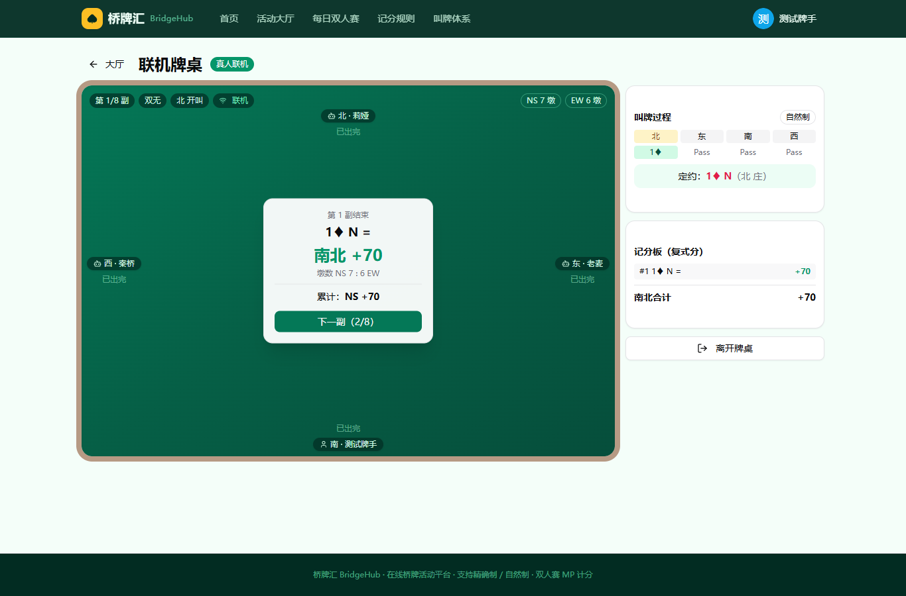
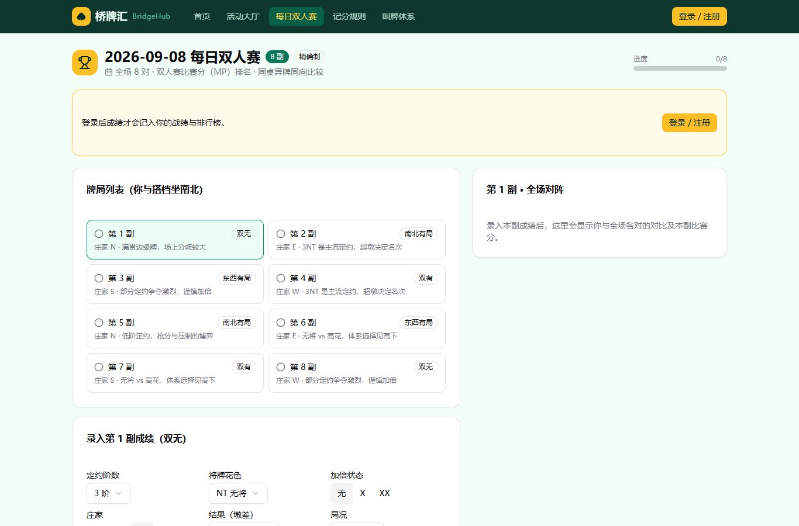
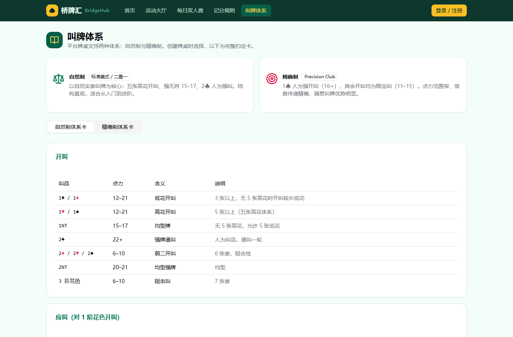
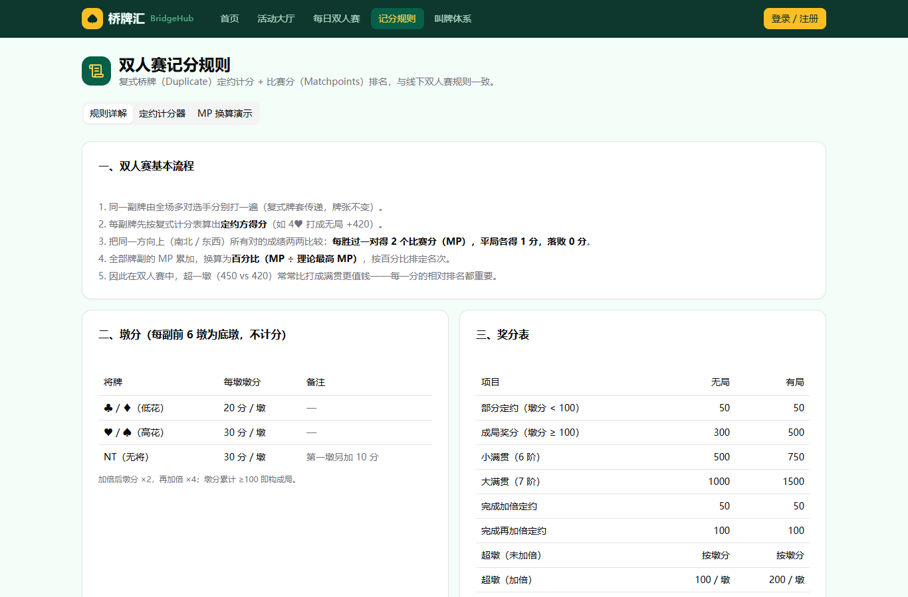
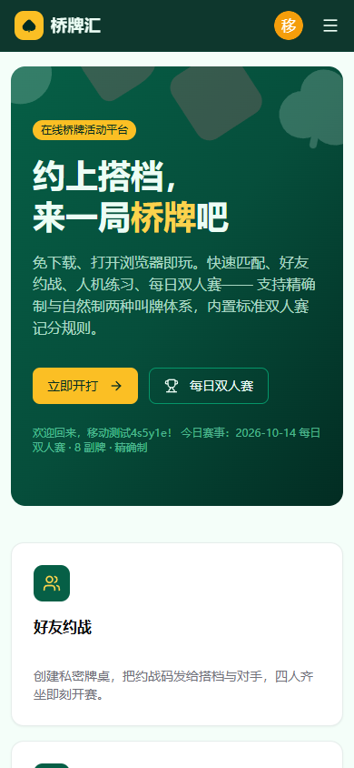
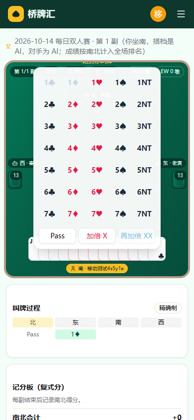

# 桥牌汇 BridgeHub

**在线桥牌活动平台** —— 免下载、打开浏览器即玩。快速匹配、好友约战、人机练习、每日双人赛，支持**精确制**与**自然制**两种叫牌体系，内置标准**双人赛（MP）记分规则**。

[](https://github.com/baiwsh/Bridge-Platform/releases/tag/v1.8.2)
[](LICENSE)
[](https://nodejs.org/)

---

## ✨ 功能特性

| 模块 | 说明 |
| --- | --- |
| 🏠 活动大厅 | 快速匹配、好友约战（约战码四人齐坐开赛）、人机练习桌 |
| 🏆 每日双人赛 | 每天 8 副牌，全场同牌竞技，比赛分（MP）排名，刷新最佳百分比 |
| 🤖 人机练习 | 与 AI 陪练对坐，熟悉精确制 / 自然制叫牌节奏，随时开桌无需等待 |
| 👤 账号体系 | 注册 / 登录，参赛成绩计入个人战绩与排行榜 |
| 📖 两种叫牌体系 | 牌桌可选**精确制（Precision Club）**或**自然制（标准美式 / 二盖一）**，内置完整约定卡速查 |
| 🧮 双人赛记分 | 复式定约计分 + 比赛分（Matchpoints）排名，与线下双人赛规则一致 |
| 🏅 队式赛记分 | **v1.7.0 新增**：WBF 标准国际序分（IMP）换算，每副折算后累计，支持 MP / IMP 两种计分方式 |
| 🔒 安全加固 | **v1.7.0 新增**：安全响应头、IP 限流与退避惩罚、请求体限制、账号枚举防护、WebSocket 接入限流；**v1.7.1** 修正限流键取值，伪造 `X-Forwarded-For` 不再能绕过限流 |
| 🃏 打牌体验 | **v1.8.0 改版**：明手**首攻后才摊牌**（符合桥牌规则）、**v1.8.1** 收墩停顿 1 秒（看清本墩又不拖节奏）、牌面与点数字号放大 50% |
| 📱 手机端可读性 | **v1.8.2 修复**：明手牌的**点数与花色不再被相邻牌遮住**——横向牌堆按视口自适应重叠、纵向牌堆角标改为单行，13 张牌也不再溢出牌桌 |
| 📱 多端适配 | 桌面、平板、手机全端自适应，手机端专属叫盘面版与紧凑牌桌 |
| 🔌 联机对战 | WebSocket 实时同步；玩家掉线自动 AI 托管，重连恢复手动 |

## 🖥️ 界面预览

### 桌面端

| 首页 | 联机牌桌 |
| --- | --- |
|  |  |

| 每日双人赛 | 叫牌体系卡 |
| --- | --- |
|  |  |

| 双人赛记分规则 |
| --- |
|  |

### 移动端

| 手机首页 | 手机叫盘面版 |
| --- | --- |
|  |  |

## 🏗️ 技术架构

前后端一体应用：

| 部分 | 技术栈 | 说明 |
| --- | --- | --- |
| 前端 | React 19 + TypeScript + Vite + Tailwind CSS + shadcn/ui | SPA，构建产物 `app/dist/` |
| 后端 | Node.js + Express 5 + ws | REST `/api/*`（账号）+ WebSocket `/ws`（牌桌实时同步） |
| 数据 | JSON 文件存储（`server/data/`） | 账号 / 会话 / 每日赛成绩持久化（演示级，可换 SQLite / PostgreSQL） |

后端自带静态托管：生产模式下一个 `node dist-server/index.js` 进程同时服务前端页面、REST 与 WebSocket（默认端口 `8100`），前置 Nginx 做入口代理。

```
Bridge-Platform/
├── app/
│   ├── src/            # 前端源码（页面 / 组件 / 牌局引擎）
│   ├── server/         # 后端源码（Express + ws）
│   ├── deploy/         # 部署资产：Dockerfile / nginx.conf / systemd unit / 部署脚本
│   ├── docs/           # 部署手册 / 用户使用手册（Markdown + PDF）
│   └── DEPLOYMENT.md   # Ubuntu 部署详细指南
└── docs/screenshots/   # README 用截图
```

## 🚀 快速开始（本地开发）

```bash
cd app
npm ci          # 安装依赖（Node.js >= 20）

# 终端 1：后端（REST + WebSocket，默认 :8100）
npm run server

# 终端 2：前端（Vite 开发服务器，默认 :5173）
npm run dev
```

## 📦 生产部署（Ubuntu）

```bash
cd app
npm ci
npm run build          # 构建前端 -> dist/
npm run build:server   # 打包后端 -> dist-server/index.js
PORT=8100 npm start    # 单进程服务前端 + REST + WebSocket
```

完整指南（含 systemd 常驻、Nginx 反代、HTTPS、Docker）请参阅：

- 📘 [Ubuntu 部署指南](app/DEPLOYMENT.md)
- 📕 [部署手册（PDF）](app/docs/部署手册.pdf)
- 📗 [用户使用手册（PDF）](app/docs/用户使用手册.pdf)

## 🃏 叫牌体系与记分

- **自然制**：五张高花开叫、强无将 15–17、2♣ 人为强叫，适合入门到进阶。
- **精确制**：1♣ 人为强开叫（16+），其余开叫均为限定叫（11–15），点力范围窄、信息传递精确。
- **双人赛记分**：复式定约计分后，同方向成绩两两比较——每胜过一对得 2 个比赛分（MP），平局各 1 分，最终按 MP 百分比排名。平台内置定约计分器与 MP 换算演示。
- **队式赛记分（IMP）**：每副先算复式分，再按 WBF 标准换算表折算成 IMP（如净胜 450 分 = 10 IMP），
  逐副累加即为全场总 IMP。IMP 超墩收益远低于 MP，更注重定约选择的稳定性。完整对照表见[用户使用手册](app/docs/用户使用手册.md) 3.4 节。

## 🔒 服务端安全

v1.7.0 起后端内置零依赖安全模块 `server/security.ts`（v1.7.1 修正限流键取值）：

- REST 请求体上限 32KB；下发 CSP / X-Frame-Options / COOP-CORP 等安全响应头并隐藏技术栈
- 注册、登录等认证接口按 IP 限流，超限进入指数退避惩罚期（响应带 `Retry-After`）
- WebSocket 按 IP 限制新建连接与认证失败次数
- 登录失败统一文案，防止账号枚举
- 客户端 IP 优先取反向代理覆写的 `X-Real-IP`，`X-Forwarded-For` 取最右侧，
  因此伪造 XFF 无法获得新的配额桶（v1.7.1）

> **部署注意**：后端位于 Nginx 之后时，必须设置 `TRUST_PROXY=1`，
> 且 Nginx 的 `/ws` 块内需重复声明 `X-Forwarded-For`（Nginx 同名指令不继承），
> 否则所有请求 IP 会被识别为 `127.0.0.1`，导致全体用户被同一个限流桶锁死。
> 详见 [部署手册](app/docs/部署手册.md) 第 5.4 节。

## 🧪 自检

```bash
cd app
npx tsx engine-test.mts   # 引擎回测：240 副守恒与合法性校验
npx tsx imp-test.mts      # IMP 换算（50 个 WBF 边界取样）、安全配置、限流键防伪造自检
node ws-test.mjs          # 联机整场（双客户端 WebSocket）
node v180-verify.mjs      # v1.8.0 打牌体验（需先起 :8100 后端与 :7100 vite；桌面/手机双视口截图）
```

`v180-verify.mjs` 会自动断言三项改版行为并输出截图到 `app/shots/`：

1. 首攻前明手为牌背（明牌数 0），首攻落地后翻牌；
2. 一墩 4 张收齐到清台的间隔约 1 秒（v1.8.1 起）；
3. 牌面实际渲染尺寸与字号较 v1.7.x 增大约 50%，且 13 张手牌不溢出视口。

## 📄 许可证

[MIT](LICENSE)
